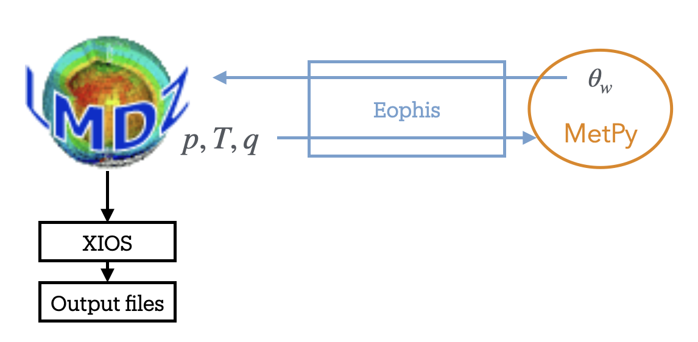

Getting started
===============

.. toctree::
   :maxdepth: 2

In this tutorial, we will deploy a hybrid experiment for LMDZ that is stored in the TRACCS-COMPACT collection. Objective of the experiment is to couple the LMDZ BENCH test case with the `MetPy <https://unidata.github.io/MetPy/latest/>`_ library to compute the wet-bulb potential temperature using the `Davies-Jones (2008) <https://doi.org/10.1175/2007MWR2224.1?utm_source=chatgpt.com>`_ formulation.

Prerequisites to the tutorial:
    - Operating LMDZ environment (see `LMDZ doc <https://lmdz.lmd.jussieu.fr/utilisateurs/installation-lmdz>`_ for help)
    - Operating Python environment
or:
    - Installed Apptainer
    - Morays container (see below)

**Apptainer on Linux**

.. code-block :: bash
    
    # For Ubuntu
    sudo apt update && sudo apt install -y software-properties-common
    sudo add-apt-repository -y ppa:apptainer/ppa
    sudo apt update && sudo apt install -y apptainer
    
    # For amd64 Debian
    sudo apt update
    sudo apt install -y wget
    cd /tmp
    wget https://github.com/apptainer/apptainer/releases/download/v1.4.3/apptainer_1.4.3_amd64.deb
    sudo apt install -y ./apptainer_1.4.3_amd64.deb
    
.. warning :: For other Linux distributions, please refer to this `guide <https://github.com/apptainer/apptainer/blob/main/INSTALL.md>`_.
 

**Apptainer on macOS**

.. code-block:: bash
    
    # Apptainer is available on macOS via LIMA (LInux virtual MAchines)
    brew install qemu lima  # Install with brew
    port install qemu lima  # Install with macports

    # Create Linux VM with Apptainer
    limactl start template://apptainer
    limactl shell apptainer
    # IMPORTANT: type 'cd' to go in VM home, 'pwd' should return '/home/<your_name>.linux'
    cd
    
    # NB: copy files from VM to host
    limactl cp apptainer:/path/to/file  /host/destination

**Run Morays container**

.. code-block:: bash

    # Get your hardware architecture
    uname -m
    #  aarch64 --> arm64
    #  x86_64  --> amd64
    ARCH=arm64

    # Download image
    wget https://github.com/morays-community/morays-doc/releases/download/containers/morays_env_${ARCH}.sif

    # Run container: should print " >>>> Welcome in Morays environment ! <<<< "
    apptainer run --writable-tmpfs --bind $(pwd):/home/jdoe/to_host morays_env_${ARCH}.sif

Introduction
------------

The LMDZ BENCH case is a realistic low-resolution atmospheric general circulation configuration designed for demonstration and educational purposes.

The wet-bulb potential temperature is a useful thermodynamic diagnostic for characterizing atmospheric moisture and stability. Its computation involves moist thermodynamic processes that can be approximated using different formulations.
The `Davies-Jones (2008) <https://doi.org/10.1175/2007MWR2224.1?utm_source=chatgpt.com>`_ (DJ08) formulation provides an accurate and computationally efficient method for estimating this quantity.
Available through the MetPy Python library, this formulation offers an alternative to the thermodynamic diagnostics currently implemented in LMDZ.
It relies on atmospheric pressure, temperature, and specific humidity, and can be evaluated independently at each grid cell.

Here is the difficulty: LMDZ is written in Fortran, while MetPy is a Python library. An interface is therefore required to allow both components to coexist and exchange data during runtime. Since LMDZ provides an OASIS3-MCT interface, we can use the Eophis library to couple an external Python script that receives the atmospheric fields, computes the wet-bulb potential temperature using MetPy, and sends the resulting diagnostic field back to LMDZ.

The experiment will execute the following steps:
    - LMDZ is modeling the atmospheric circulation
    - It sends the atmospheric fields towards the Python script every time step of the physic core
    - The MetPy Python script computes the DJ08 wet-bulb temperature
    - Results are sent back to LMDZ and written in an output file with XIOS

1. Software environment
-----------------------

Every hybrid experiments with LMDZ require a couple of shared libraries. We quickly summarize the steps to install them.

.. note::

    If you are running Morays container, you can skip this part until section 2.
  
  

Compile OASIS3-MCT_v5.0
~~~~~~~~~~~~~~~~~~~~~~~

OASIS3-MCT is the coupling library on which both LMDZ and Eophis rely to perform field exchanges. OASIS3-MCT_v5.0 is the minimal required version and must be dynamically compiled. See `OASIS3-MCT documentation <https://oasis.cerfacs.fr/en/documentation/>`_ for more details.

.. code-block:: bash

    # Clone OASIS3-MCT_v5.0
    cd ~/
    git clone https://gitlab.com/cerfacs/oasis3-mct.git
    cd ~/oasis3-mct
    git checkout OASIS3-MCT_5.0
    cd util/make_dir
    
Edit your own ``make.<YOUR_ARCH>`` file. Pay attention to the following important variables:

.. code-block:: makefile

     # Dynamic flags
     DYNOPT = -fPIC
     LDDYNOPT = -shared
     # inc and lib dir
     NETCDF_INCLUDE = /PATH/TO/NETCDF/include
     NETCDF_LIBRARY = -L/PATH/TO/NETCDF/lib -lnetcdf -lnetcdff
     MPI_INCLUDE = /PATH/TO/MPI/include
     MPILIB = -L/PATH/TO/MPI/lib -lmpi
     # Compilers and linker
     F90 = # mpifort -I$(MPI_INCLUDE) , ftn , mpiifort ...
     CC =  # mpicc , cc , mpiicc ...
     LD = $(F90) $(MPILIB)
     # Compilation flags - adapt with your compilers
     FCBASEFLAGS = -O2 ...
     CCBASEFLAGD = -O2 ...

.. code-block:: bash
    
    # Link your architecture file for compilation
    echo "include ~/oasis3-mct/util/make_dir/make.<YOUR_ARCH>"  >  make.inc
     
    # Compile dynamic libraries
    make -f TopMakefileOasis3 pyoasis

    # Libraries should be there
    ls ~/oasis3-mct/BLD/lib/
    libmct.so   libmpeu.so   liboasis.cbind.so   libpsmile.MPI1.so   libscrip.so

    
Activate OASIS3-MCT Python API. The best is to put this command in your ``bash_profile``:

.. code-block :: bash

    source ~/oasis3-mct/BLD/python/init.sh
    

Compile XIOS with OASIS3-MCT
~~~~~~~~~~~~~~~~~~~~~~~~~~~~

XIOS is used by LMDZ to write results. It must be compiled with the abovementioned OASIS3-MCT libraries. See `XIOS documentation <https://forge.ipsl.jussieu.fr/ioserver/wiki/documentation>`_ for more details about compilation of XIOS with OASIS3-MCT.

.. code-block:: bash

    # Clone XIOS
    cd ~/
    git clone -b XIOS2 https://gitlab.in2p3.fr/ipsl/projets/xios-projects/xios.git XIOS_OASIS
    cd ~/XIOS_OASIS/

Edit your ``arch-<YOUR_MACHINE>.path`` file to include the OASIS3-MCT libraries directories and bindings:

.. code-block:: bash

    # edit arch files
    vi archs/arch-<YOUR_MACHINE>.path
        # ...
        OASIS_INCDIR="-I~/oasis3-mct/BLD/include/ -I~/oasis3-mct/BLD/build-shared/lib/cbindings/"
        OASIS_LIBDIR="-L~/oasis3-mct/BLD/lib"
        OASIS_LIB="-loasis.cbind -lpsmile.MPI1 -lscrip -lmct -lmpeu"

.. code-block:: bash

    # Compile
    ./make_xios --full --prod --arch <YOUR_MACHINE> --use_oasis oasis3_mct

    # library should be here
    ls lib/
    libxios.a

2. Experiment environment
-------------------------

Now that we have set up the common environment for all hybrid LMDZ experiments, we need to install the dependencies related to the specific experiment of interest. Let's find it in the `TRACCS-COMPACT repositories <https://github.com/orgs/TRACCS-COMPACT/repositories>`_. Those are named with a simple convention: ``<CODE>-<EXPERIMENT>``. The corresponding repository for the tutorial is then ``LMDZ-BENCH32x32x39``:

.. code-block:: bash

    mkdir -p ~/to_host
    cd ~/to_host
    git clone https://github.com/TRACCS-COMPACT/LMDZ-BENCH32x32x39.git

The repository contains a ``README`` with informations about experiment context and motivations.

The other informations listed in ``README`` are the software requirements:
    - **Compilation:** code version to compile and with which potential additionnal material
    - **Python:** Eophis version to install and potential additional Python material
    - **Run:** submission tools to manage the experiment execution
    - **Post-Process:** post-processing libraries and plotting tools

In accordance with the ``README`` content, we must install *LMDZ6 trunk 5891* with help of *install_lmdz.sh* script and *Eophis_v1.1.0*. Other tools and scripts are already contained in the repository.

.. code-block:: bash

    # Clone LMDZ6
    cd ~/to_host
    wget http://lmdz.lmd.jussieu.fr/pub/install_lmdz.sh
    chmod +x install_lmdz.sh
    ./install_lmdz.sh -name LMDZ6_PY -netcdf 0 -parallel mpi_omp -veget none -rad oldrad
    
    # Clone and install Eophis_v1.1.0
    cd ~/to_host
    git clone --branch v1.1.0 https://github.com/meom-group/eophis eophis_v1.1.0
    cd eophis_v1.1.0
    pip install .
    
    # README instructions for DJ08
    cd LMDZ-BENCH32x32x39/BENCH32x32x39.DJ08/INFERENCES
    pip install -r requirements.txt

    
    
We will now browse the directories of the ``BENCH32x32x39.DJ08`` experiment to deploy the test case.

.. code-block:: bash

    ls ~/to_host/LMDZ-BENCH32x32x39/BENCH32x32x39.DJ08/
    CONFIG  INFERENCES  POST-PROCESS  RES  RUN

3. CONFIG - LMDZ case
---------------------

This directory contains the material to compile LMDZ. Since the **Compilation** section of the ``README`` did not mention any specific tool for the compilation, we will follow the standard `modipsl configuration structure <https://ipsl.pages.in2p3.fr/icmc/plateforme/documentation/igcmg_doc/Install/>`_. Note that the latter is automatically deployed with the ``install_lmdz.sh`` script that we used earlier.

.. code-block:: bash

    # Create config -- it already exists, we juste move it
    mv ~/to_host/LMDZ6_PY/modipsl/modeles/LMDZ/BENCH32x32x39   ~/to_host/LMDZ6_PY/modipsl/config

A compilation script is given in the CONFIG directory:
    
.. code-block:: bash

    # Copy compilation script
    cp ~/to_host/LMDZ-BENCH32x32x39/BENCH32x32x39.DJ08/CONFIG/compile.sh   ~/to_host/LMDZ6_PY/modipsl/modeles/LMDZ

The architecture files are compulsory to compile LMDZ. Templates for the experiment are also given in CONFIG and are compatible with the Morays container. Depending on your hardware environment, they might not be not suitable. Feel free to copy and edit them in accordance with your machine. If so, be sure to have the OASIS3-MCT and XIOS paths corresponding to those compiled with OASIS3-MCT_v5.0 libraries.

.. code-block:: bash

    # Copy arch files
    cp ~/to_host/LMDZ-BENCH32x32x39/BENCH32x32x39.DJ08/CONFIG/arch-*   ~/to_host/LMDZ6_PY/modipsl/modeles/LMDZ/arch

Generic hybrid LMDZ patch
~~~~~~~~~~~~~~~~~~~~~~~~~

``README`` mentionned that the LMDZ sources must be completed with the TRACCS-COMPACT patch. It provides the minimal LMDZ sources modifications to set up a hybrid experiment. They enable flexible external communication through the OASIS3-MCT module. We can obtain them by cloning this repository:

.. code-block:: bash

    cd ~/to_host
    git clone https://github.com/TRACCS-COMPACT/Hybrid_Python-LMDZ.git

We transfer the patch sources for LMDZ to our test case:

.. code-block:: bash

    # Copy patch sources in corresponding LMDZ source directories
    cd ~/to_host/Hybrid_Python-LMDZ/LMDZ_Patches/LMDZ6
    cp cpl_mod.F90 oasis.F90 pyfld.F90 pycpl.F90 eophis_def.F90 phyetat0_mod.f90   ~/to_host/LMDZ6_PY/modipsl/modeles/LMDZ/libf/phylmd
    cp mod_const_mpi.F90 parallel_lmdz.F90   ~/to_host/LMDZ6_PY/modipsl/modeles/LMDZ/libf/dyn3dmem

Experiment patch
~~~~~~~~~~~~~~~~

``README`` also specified to patch LMDZ with the experiment specific sources. The TRACCS-COMPACT patch does not configure the external communication module in accordance with ``BENCH32x32x39.DJ08``, but the experiment patch does. It also contains the code to write the outsourced fields. It is also stored in CONFIG:

.. code-block:: bash

    # Copy experiment sources
    cp  ~/to_host/LMDZ-BENCH32x32x39/BENCH32x32x39.DJ08/CONFIG/my_src/*   ~/to_host/LMDZ6_PY/modipsl/modeles/LMDZ/libf/phylmd

Now we have everything required to compile LMDZ:

.. code-block:: bash

    cd  ~/to_host/LMDZ6_PY/modipsl/modeles/LMDZ
    ./compile.sh

    # save executable
    cp  ~/to_host/LMDZ6_PY/modipsl/modeles/LMDZ/bin/gcm_32x32x39_phylmd_oldrad_para_mem_couple.e  ~/to_host/LMDZ6_PY/modipsl/bin

4. RUN - LMDZ settings
----------------------

This directory contains all the production material, such as XIOS configuration files and LMDZ namelists. We need them obviously:

.. code-block:: bash
    
    # Copy xml files and namelists
    cp -r  ~/to_host/LMDZ-BENCH32x32x39/BENCH32x32x39.DJ08/RUN/*   ~/to_host/LMDZ6_PY/modipsl/config/BENCH32x32x39

In RUN is also contained the execution material for the experiment. Except ``job.ksh``, no particular tool to manage the run is specified in ``README``.
Script ``job.ksh`` assumes that LMDZ will run on a HPC system via a SBATCH scheduler. Adapt script content or remove SBATCH header if necessary.

5. INFERENCES - Python material
-------------------------------

This directory contains the Python scripts for hybrid modeling. It also includes additional packages for the Python model (if necessary). Here, MetPy is imported and used in accordance with the experiment objectives in ``models.py``. Finally, ``eophis_main.py`` contains the Eophis instructions to couple ``models.py`` with LMDZ.  Let's copy them in a modipsl dedicated directory:

.. code-block:: bash

    # Create directory dedicated to Python
    mkdir -p ~/to_host/LMDZ6_PY/modipsl/modeles/PYTHON
    cp ~/to_host/LMDZ-BENCH32x32x39/BENCH32x32x39.DJ08/INFERENCES/*   ~/to_host/LMDZ6_PY/modipsl/modeles/PYTHON
    
    
We already installed Python model dependencies in section **2. Experiment environment**. It may be tested by running ``models.py`` as a standalone script:

.. code-block:: bash

    cd ~/to_host/LMDZ6_PY/modipsl/modeles/PYTHON
    python3 ./models.py
    # Should print "Test successful"
        
    

6. Running the experiment
-------------------------

Everything is ready to execute the hybrid experiment. Submit the run with ``job.ksh`` in accordance with your computing environment. If you are not running LMDZ on a HPC system, execute commands below inside the config directory:

.. code-block:: bash

    cd  ~/to_host/LMDZ6_PY/modipsl/config/BENCH32x32x39

    # clean working directory
    touch namcouple
    touch eophis_nml
    rm namcouple*
    rm eophis_nml

    # get executable and execution material
    cp ../../bin/gcm_32x32x39_phylmd_oldrad_para_mem_couple.e  lmdz_cpl.e
    cp -r ../../modeles/PYTHON/*  .
    cp XML/*  .
    cp PARAM/*  .

    # execute eophis in preproduction mode to generate namcouple
    python3 ./eophis_main.py --exec preprod
    
    # save eophis preproduction logs
    mv eophis.out eophis_preprod.out
    mv eophis.err eophis_preprod.err
    
    # run LMDZ-DJ08
    mpirun -np 1 ./lmdz_cpl.e : -np 1 python3 ./eophis_main.py --exec prod

.. warning :: If you are using the `libIGCM Tools suite <https://ipsl.pages.in2p3.fr/icmc/plateforme/documentation/igcmg_doc/Tools/>`_, above commands are automatically handled. Be careful on the paths defined in the run cards.

If run is going well, Eophis log should contain messages like these:

.. code-block:: bash

    tail eophis.out
    Iteration 2: 900s -- 0:15:00
       Treating pres, temp, q_spec received through tunnel TO_LMDZ
       Sending back theta_w through tunnel TO_LMDZ
    Iteration 3: 1800s -- 0:30:00
       Treating pres, temp, q_spec received through tunnel TO_LMDZ
       Sending back theta_w through tunnel TO_LMDZ
    Iteration 4: 2700s -- 0:45:00
       Treating pres, temp, q_spec received through tunnel TO_LMDZ
       Sending back theta_w through tunnel TO_LMDZ

This means that the exchanges are well performed. Check out also that output file ``histday.nc`` has been created. It contains the diagnostic field computed by DJ08 formulation.

7. POST-PROCESS and RES
-----------------------

POST-PROCESS directory contains material and/or scripts to compute and plot results. The latter are stored in the RES directory to be available for consultation. In this tutorial, only a simple Python script ``plot_res.py`` should be executed to plot figures. Required dependencies are also given.

.. code-block:: bash

    # install dependencies, if necessary
    cd ~/to_host/LMDZ-BENCH32x32x39/BENCH32x32x39.DJ08/POST-PROCESS/
    pip install -r requirements.txt
    cp plots_res.py  ~/to_host/LMDZ6_PY/modipsl/config/BENCH32x32x39
    
    # Plot, you might need to exit container (and lima VM) to visualize figures
    cd ~/to_host/LMDZ6_PY/modipsl/config/BENCH32x32x39
    python3 ./plots_res.py

If everything went good, we should have similar figures than those stored in RES.

Going further
-------------

From now on, you have an usable deployed Morays experiment for NEMO. Do not hesitate to check out and deploy other test cases to get inspired.

Here are the locations where you can play with:
    - global coupling settings: ``eophis_main.py``
    - Fortran interface: functions ``send_to_python_phys()`` , ``receive_from_python_phys()`` from ``pycpl.F90``
    - fields sent by LMDZ: ``physiq_mod.f90``
    - computation of Python fields and ML model configuration: ``models.py``
    - received fields in LMDZ: ``physiq_mod.f90`` and ``pyfld.f90``
    - LMDZ settings: .def and .xml files
 
Next sections provide more details on how to configure the LMDZ external communication module, and to create a hybrid experiment for LMDZ from scratch.
