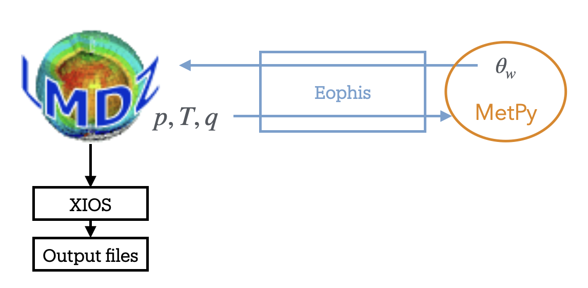

Tutorial: Create a hybrid experiment for LMDZ
=============================================


.. toctree::
   :maxdepth: 2


In this tutorial we will create a hybrid experiment for LMDZ from scratch. Objective of the experiment is to couple the LMDZ BENCH test case with the `MetPy <https://unidata.github.io/MetPy/latest/>`_ library to compute the wet-bulb potential temperature using the `Davies-Jones (2008) <https://doi.org/10.1175/2007MWR2224.1?utm_source=chatgpt.com>`_ formulation.


Prerequisites to the tutorial:
    - Operating LMDZ environment with XIOS (see `LMDZ doc <https://lmdz.lmd.jussieu.fr/utilisateurs/installation-lmdz>`_ for help)
    - Operating Python environment
    - Operating Morays environment (see `here <https://morays-doc.readthedocs.io/en/latest/nemo.getting_started.html#morays-environment>`_)
or:
    - Installed Apptainer
    - Morays container (see below)
    
    
**Apptainer on Linux**

.. code-block :: bash
    
    # For Ubuntu
    sudo apt update && sudo apt install -y software-properties-common
    sudo add-apt-repository -y ppa:apptainer/ppa
    sudo apt update && sudo apt install -y apptainer
    
    # For amd64 Debian
    sudo apt update
    sudo apt install -y wget
    cd /tmp
    wget https://github.com/apptainer/apptainer/releases/download/v1.4.3/apptainer_1.4.3_amd64.deb
    sudo apt install -y ./apptainer_1.4.3_amd64.deb
    
.. warning :: For other Linux distributions, please refer to this `guide <https://github.com/apptainer/apptainer/blob/main/INSTALL.md>`_.
 

**Apptainer on macOS**

.. code-block:: bash
    
    # Apptainer is available on macOS via LIMA (LInux virtual MAchines)
    brew install qemu lima  # Install with brew
    port install qemu lima  # Install with macports

    # Create Linux VM with Apptainer
    limactl start template://apptainer
    limactl shell apptainer
    # IMPORTANT: type 'cd' to go in VM home, 'pwd' should return '/home/<your_name>.linux'
    cd
    
    # NB1: copy files from VM to host
    limactl cp apptainer:/path/to/file  /host/destination
    

**Run Morays container**

.. code-block:: bash

    # Get your hardware architecture
    uname -m
    #  aarch64 --> arm64
    #  x86_64  --> amd64
    ARCH=arm64

    # Download image
    wget https://github.com/morays-community/morays-doc/releases/download/containers/morays_env_${ARCH}.sif

    # Run container: should print " >>>> Welcome in Morays environment ! <<<< "
    apptainer run --writable-tmpfs --bind $(pwd):/home/jdoe/to_host morays_env_${ARCH}.sif

        
        
Introduction
------------

The LMDZ BENCH case is a realistic low-resolution atmospheric general circulation configuration designed for demonstration and educational purposes.

The wet-bulb potential temperature is a useful thermodynamic diagnostic for characterizing atmospheric moisture and stability. Its computation involves moist thermodynamic processes that can be approximated using different formulations.
The `Davies-Jones (2008) <https://doi.org/10.1175/2007MWR2224.1?utm_source=chatgpt.com>`_ (DJ08) formulation provides an accurate and computationally efficient method for estimating this quantity.
Available through the MetPy Python library, this formulation offers an alternative to the thermodynamic diagnostics currently implemented in LMDZ.
It relies on atmospheric pressure, temperature, and specific humidity, and can be evaluated independently at each grid cell.

Here is the difficulty: LMDZ is written in Fortran, while MetPy is a Python library. An interface is therefore required to allow both components to coexist and exchange data during runtime. Since LMDZ provides an OASIS3-MCT interface, we can use the Eophis library to couple an external Python script that receives the atmospheric fields, computes the wet-bulb potential temperature using MetPy, and sends the resulting diagnostic field back to LMDZ.





The experiment will execute the following steps:
    - LMDZ is modeling the atmospheric circulation
    - It sends the atmospheric fields towards the Python script every time step of the physics core
    - The MetPy Python script computes the DJ08 wet-bulb temperature
    - Results are sent back to LMDZ and written in an output file with XIOS


1. Run standard BENCH32x32x39
-----------------------------

We start by running standard BENCH32x32x39 without DJ08. Get a copy of LMDZ6:

.. code-block:: bash

    # Clone LMDZ
    mkdir -p ~/to_host
    cd ~/to_host
    wget http://lmdz.lmd.jussieu.fr/pub/install_lmdz.sh
    chmod +x install_lmdz.sh
    ./install_lmdz.sh -name LMDZ6_PY -netcdf 0 -parallel mpi_omp -veget none -rad oldrad -bench 0


Config material and arch file for the tutorial are accessible in this repository:
    
.. code-block:: bash

    # Clone tutorial material
    cd ~/to_host/
    git clone https://github.com/TRACCS-COMPACT/Hybrid_Python-LMDZ.git


Build config:
    
.. code-block:: bash

    # Download and create BENCH config
    wget --no-check-certificate -nv -P ~/to_host/LMDZ6_PY/modipsl/config  http://lmdz.lmd.jussieu.fr/pub/3DBenchs/bench_lmdz_32x32x39.tar.gz
    tar -xf ~/to_host/LMDZ6_PY/modipsl/config/bench_lmdz_32x32x39.tar.gz   -C  ~/to_host/LMDZ6_PY/modipsl/config
    
    # Get arch files -- adapt them if you are not running Morays container
    cp ~/to_host/Hybrid_Python-LMDZ/TUTO/arch/*   ~/to_host/LMDZ6_PY/modipsl/modeles/LMDZ/arch
    
    # Compile
    cd ~/to_host/LMDZ6_PY/modipsl/modeles/LMDZ/
    ./makelmdz_fcm -prod -config Bench -arch local-gfortran-parallel -j 8 -p lmd -d 32x32x39 -v false -mem -parallel mpi_omp -io xios gcm


and run LMDZ:

.. code-block:: bash

    # Get input files
    cp ~/to_host/Hybrid_Python-LMDZ/TUTO/XML/*   ~/to_host/LMDZ6_PY/modipsl/config/BENCH32x32x39

    # Modify namelists
    cd ~/to_host/LMDZ6_PY/modipsl/config/BENCH32x32x39
    sed -i 's/iflag_rrtm=1/iflag_rrtm=0/' physiq.def
    sed -i 's/NSW=6/NSW=2/' physiq.def
    echo "ok_all_xml=y" >> run.def
    
    # Execute
    cp ~/to_host/LMDZ6_PY/modipsl/modeles/LMDZ/bin/gcm_32x32x39_phylmd_oldrad_para_mem.e  gcm.e
    ./gcm.e
    
You should find netcdf file ``histday.nc`` among others when done.
 
 

2. Run DJ08 formulation
-----------------------

We have an operating LMDZ configuration. Let's focus now on the DJ08 formulation. As mentionned earlier, it must be written in an external Python script. DJ08 code and an implementation of the formulation are provided in the tutorial repository:

.. code-block:: bash

    # Install MetPy
    cd ~/to_host/Hybrid_Python-LMDZ/TUTO/DJ08
    pip install -r requirements.txt

Edit ``~/to_host/Hybrid_Python-LMDZ/TUTO/DJ08/models.py``, a function ``sub_wet_temp()`` taking numpy arrays for all required inputs is already defined. Complete ``sub_wet_temp()`` as follows to compute the dewpoint from specific humidity, and the wet-bulb potential temperature:


.. code-block:: python

    # -- dewpoint from specific humidity (WMO8 eq. 4.A.6)
    Td_q = mpcalc.dewpoint_from_specific_humidity(pressure=p_q, specific_humidity=q_q)

    # -- theta_e (Bolton 1980) then theta_w (Davies-Jones 2008 polynomial)
    theta_w = mpcalc.wet_bulb_potential_temperature(pressure=p_q, temperature=T_q, dewpoint=Td_q)


Script ``models.py`` can be executed lonely with user-defined typical values as inputs (feel free to modify them). Run it to check that the model works correctly:

.. code-block :: bash

    python3 ./models.py
    # Should print:
    #    Res    -- <theta_w>: ...
    #    Test successful


.. note ::

    We have now an operating DJ08 script. However, ``models.py`` does not possess an OASIS3-MCT interface and cannot be coupled with LMDZ. In the next sections, we will build the Eophis scripts and configure LMDZ to set up the coupling.


3. Set up coupling environment
------------------------------

Time has come to install Eophis:

.. code-block :: bash

    # Clone and install Eophis_v1.1.0
    cd ~/to_host
    git clone --branch v1.1.0 https://github.com/meom-group/eophis eophis_v1.1.0
    cd eophis_v1.1.0
    pip install .


Define the exchanges
~~~~~~~~~~~~~~~~~~~~

An Eophis script is provided in the DJ08 repository (``~/to_host/Hybrid_Python-LMDZ/TUTO/DJ08/main.py``). The script may execute ``preproduction()`` or ``production()``. The first function is used to generate coupling material. The second one contains instructions to perform the coupling itself. For both, we need to define what we want to exchange in ``earth_info()``. According to the diagram in introduction:

Eophis needs to receive from LMDZ:
    - Fields ``pres``, ``temp`` and ``q_spec`` at each physics time step, on grid ``(32,33,39)``
and to send back results from DJ08:
    -  ``theta_w`` at each physics time step, on grid ``(32,33,39)``


In Eophis, exchanges are defined in Tunnel. An empty Tunnel ``TO_EARTH`` (step 1) already exists:

.. code-block :: python

    tunnel_config = list()
    tunnel_config.append( { 'label' : 'TO_LMDZ', \
                            'grids' : {}, \
                            'exchs' : [ {} ] }
                        )

Define the surface grid on which exchanges will be performed (i.e. 1 point grid):

.. code-block :: python

    tunnel_config = list()
    tunnel_config.append( { 'label' : 'TO_LMDZ', \
                            'grids' : { 'lmdz' : {'npts' : (32,33)} }, \
                            'exchs' : [ {} ] }
                        )


What remains is to define exchanges themselves. According to LMDZ namelist, time step is ``900s``. Following `Tunnel documentation <https://eophis.readthedocs.io/en/latest/usage.html#tunnel>`_, we can complete exchanges definition with:

.. code-block :: python

    tunnel_config = list()
    tunnel_config.append( { 'label' : 'TO_LMDZ', \
                            'grids' : { 'lmdz' : {'npts' : (32,33)} }, \
                            'exchs' : [ {'freq' : 900, 'grd' : 'lmdz', 'lvl' : 39, 'in' : ['pres','temp','q_spec'], 'out' : ['theta_w']} ] }
                        )


The exchange line may be read as:

    every ``900`` seconds, execute the receiving of field ``pres``, ``temp``, ``q_spec``, and the sending back of fields ``theta_w`` on the ``39``` levels of grid ``lmdz``.

Create Tunnel object (step 2) with:

.. code-block :: python

    to_lmdz, = eophis.register_tunnels( tunnel_config )


Generate OASIS3-MCT material
~~~~~~~~~~~~~~~~~~~~~~~~~~~~

OASIS3-MCT material is generated with ``write_coupling_namelist()``, which requires total simulation time as argument. This information is available in LMDZ namelists ``namelist_cfg``. The latter is read and returned by ``earth_info()``. Thus, get namelist parameters (step 3) with:
    
.. code-block :: python

    step = int( 24*3600 / day_step * iphysiq )
    ite_end = int(24*3600*nday / step)
    ite_0 = 1

and use them to write OASIS3-MCT namelist (step 4):

.. code-block :: python

    total_time = (it_end - it_0 + 1) * step
    eophis.write_coupling_namelist( simulation_time=total_time )

Eophis preproduction script is ready to be executed:

.. code-block :: bash

    python3 ./main.py --exec preprod

Four files have been created: Eophis logs ``eophis.out``, ``eophis.err``, OASIS3-MCT namelist ``namcouple``, and Eophis Fortran namelist ``eophis_nml``.


Connect models
~~~~~~~~~~~~~~

We complete function ``production()`` to drive exchanges all along the run. Since the Tunnel is already created, deploy the OASIS3-MCT interface (step 5) with:

.. code-block :: python

    eophis.open_tunnels()

Coupling is effective. Fields can be received and used as arguments for W25. Import it (step 6):

.. code-block :: python

    from models import sub_wet_temp
    
    
Exchanges must be synchronized in time, this is done by Loop. Loop requires a Tunnel to work with, number of time iteration, and time step value. Define Loop (step 7) as follows:

.. code-block :: python

    @eophis.all_in_all_out( geo_model=to_lmdz, step=step, niter=niter )


Final step is to specify connexions between the exchanged data and W25. Connect received data, data to send and W25 in ``loop_core()`` (step 8):

.. code-block :: python

    def loop_core(**inputs):
        outputs = {}
        outputs['theta_w'] = sub_wet_temp( inputs['pres'], inputs['temp'], inputs['q_spec'] )

        return outputs


Note that all these components describe only pipelines, identified by the field names. We will now configure LMDZ in accordance with the coupling environment defined by Eophis. The objective is to choose which array will be passed through OASIS3-MCT along these pipelines.


4. Build BENCH32x32x39.DJ08
---------------------------

OASIS3-MCT-built LMDZ
~~~~~~~~~~~~~~~~~~~~~

BENCH32x32x39.DJ08 models the same BENCH32x32x39 circulation. Duplicate the case:

.. code-block:: bash

    # Duplicate BENCH32x32x39 test case
    cd ~/to_host/LMDZ6_PY/modipsl/config
    cp -r BENCH32x32x39   BENCH32x32x39.DJ08
    

OASIS3-MCT and XIOS (compiled with OASIS3-MCT) must be linked during LMDZ compilation. Duplicate arch files and include them:

.. code-block :: bash

    # New arch file
    cd ~/to_host/LMDZ6_PY/modipsl/modeles/LMDZ/arch
    cp arch-local-gfortran-parallel.fcm   arch-local-gfortran-parallel-cpl.fcm
    cp arch-local-gfortran-parallel.env   arch-local-gfortran-parallel-cpl.env
    cp arch-local-gfortran-parallel.path  arch-local-gfortran-parallel-cpl.path

    # Modify following lines: template is valid for Morays container
    vi arch-local-gfortran-parallel-cpl.path
        # ...
        %XIOS_HOME      /home/jdoe/XIOS_OASIS
        # ...
        OASIS_INCDIR="-I/home/jdoe/oasis3-mct/BLD/include"
        OASIS_LIBDIR="-L/home/jdoe/oasis3-mct/BLD/lib"
        OASIS_LIB="-loasis.cbind -lpsmile.MPI1 -lscrip -lmct -lmpeu"


Finally configure XIOS to be aware of OASIS3-MCT environment:

.. code-block:: bash

    vi ~/to_host/LMDZ6_PY/modipsl/config/BENCH32x32x39.DJ08/iodef.xml
        # ...
        <variable id="using_oasis"               type="bool">true</variable>


Minimal LMDZ sources modifications are required to set up a hybrid Python-LMDZ experiment. Those modifications are provided by the TRACCS-COMPACT patch. It enables creation of independent OASIS3-MCT modules. It can be obtained from the repository that we have already cloned for the tutorial. We tranfer the patch sources to those of LMDZ:


.. code-block :: bash

    cd ~/to_host/Hybrid_Python-LMDZ/LMDZ_Patches/LMDZ6
    cp cpl_mod.F90 oasis.F90 pyfld.F90 pycpl.F90 eophis_def.F90 phyetat0_mod.f90   ~/to_host/LMDZ6_PY/modipsl/modeles/LMDZ/libf/phylmd
    cp mod_const_mpi.F90 parallel_lmdz.F90   ~/to_host/LMDZ6_PY/modipsl/modeles/LMDZ/libf/dyn3dmem


Configure NEMO
~~~~~~~~~~~~~~

The patch comes with pre-defined Python communication modules ``pyfld.f90`` and ``pycpl.F90``. Edit ``pyfld.F90`` to allocate arrays where fields returned by DJ08 will be stored:

.. code-block :: bash

    vi ~/to_host/LMDZ6_PY/modipsl/modeles/LMDZ/libf/phylmd/pyfld.F90


.. code-block :: Fortran
    
        ! Line 30
        REAL, PUBLIC, ALLOCATABLE, SAVE, DIMENSION(:,:)  :: theta_w
        !$OMP THREADPRIVATE(theta_w)
        ! Line 70
        ALLOCATE( theta_w(klon, klev) )


Import communication modules in ``physiq_mod.F90``, as it is the location where we will call the Python script:


.. code-block :: bash
    
    vi ~/to_host/LMDZ6_PY/modipsl/modeles/LMDZ/libf/phylmd/physiq_mod.F90

.. code-block :: Fortran

    ! Line 409
    USE pyfld
    USE pycpl


The functions in LMDZ for sending or receiving arrays to or from Python in accordance with Eophis are ``send_to_python_phys()`` and ``receive_from_python_phys()``, respectively. They take the field name defined in Eophis exchanges, the array to send or in which to store the results, and the current LMDZ physics time step as arguments. Proceed sendings and receptions in ``physiq_mod.F90`` with:


.. code-block :: Fortran

    ! Line 2499
    ! Send inputs
    CALL send_to_python_phys('pres', pplay, itap)
    CALL send_to_python_phys('temp', t_seri, itap)
    CALL send_to_python_phys('q_spec', q_seri, itap)
    ! Receive
    CALL receive_from_python_phys('theta_w', theta_w, itap)


For the tutorial, nothing will be done with ``theta_w`` array but its content, computed on the Python side, is now available in LMDZ.


Finally build LMDZ with compilation flag ``-c true`` and ``key_eophis`` CPP key:


.. code-block :: bash

    # Compile
    cd ~/to_host/LMDZ6_PY/modipsl/modeles/LMDZ/
    ./makelmdz_fcm -prod -config Bench -arch local-gfortran-parallel-cpl -j 8 -cpp key_eophis -p lmd -d 32x32x39 -v false -mem -parallel mpi_omp -io xios -c true gcm
    


5. Run BENCH32x32x39.DJ08
-------------------------

Complete BENCH32x32x39.DJ08 config with Eophis and DJ08 Python scripts:

.. code-block :: bash

    # Get Python material
    cp ~/to_host/Hybrid_Python-LMDZ/TUTO/DJ08/*.py   ~/to_host/LMDZ6_PY/modipsl/config/BENCH32x32x39.DJ08/


Re-execute Eophis preproduction in config and run LMDZ-Eophis:

.. code-block :: bash

    cd ~/to_host/LMDZ6_PY/modipsl/config/BENCH32x32x39.DJ08/

    # Get LMDZ-OASIS3-MCT executable
    cp ~/to_host/LMDZ6_PY/modipsl/modeles/LMDZ/bin/gcm_32x32x39_phylmd_oldrad_para_mem_couple.e  gcm_cpl.e

    # Run hybrid LMDZ
    python3 ./main.py --exec preprod
    mpirun -np 1 ./gcm_cpl.e : -np 1 python3 ./main.py --exec prod


Going further
-------------

You have seen the minimal steps to set up a hybrid LMDZ experiment. We invite you to read `Eophis tutorial <https://eophis.readthedocs.io/en/latest/tutorial.html>`_ and `configuration guide for LMDZ <https://morays-doc.readthedocs.io/en/latest/lmdz.api.html>`_ to discover advanced coupling features.

If this tutorial helped you to build a new hybrid experiment with LMDZ, it would be greatly apreciated if you could `contribute to the TRACCS-COMPACT collection <https://morays-doc.readthedocs.io/en/latest/contribute.html>`_.
