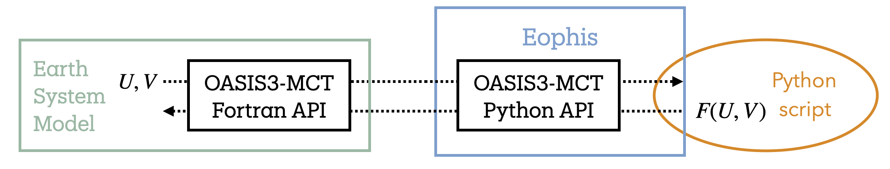

Hybrid Python-LMDZ
==================

This `TRACCS-COMPACT`_ project provides a collection of deployment examples of the `Eophis`_ package in `LMDZ`_. It also proposes a solution for sharing the model experiments across centers.

-------------------------------

`OASIS3-MCT`_ is a parallelized coupling library that performs field exchanges between coupled Earth System Model components. Eophis is a Python library that facilitates the creation and the configuration of an OASIS3-MCT environment in a Python script to couple with Fortran ESM. It can be deployed with any ESM that does possess an OASIS3-MCT interface.

In this context, a hybrid LMDZ experiment with Eophis is an atmospheric GCM simulation in which LMDZ sends fields towards an external Python script through OASIS3-MCT, and deployed by Eophis. The results computed by the Python model are sent back to the atmosphere and used for the solution.

Typical applications include:
    - Hybrid Machine Learning (ML) / Physics modeling
    - Deployment of fast evolving high-level libraries in stable low-level codes
    - Prototypal code testing

-------------------------------

All the experiments are documented in a self contained separate GitHub repository, that provides all the material for reproducing the use case. List of available experiments can be found in this `section <https://hybrid-python-lmdz.readthedocs.io/en/latest/lmdz_exp.html>`_. A last objective of this documentation is to give detailed guidelines to create custom hybrid LMDZ test cases.

.. note ::

    Newcomers are welcome to start with this tutorial:
        - `Reproduce an existing hybrid LMDZ experiment <https://hybrid-python-lmdz.readthedocs.io/en/latest/lmdz.getting_started.html>`_

    People familiar with Eophis or LMDZ are encouraged to follow this tutorial:
        - `Create a hybrid LMDZ experiment <https://hybrid-python-lmdz.readthedocs.io/en/latest/lmdz.tuto.html>`_

    Advanced users can find advanced tools and informations in corresponding model sections:
        - `LMDZ-Eophis <https://hybrid-python-lmdz.readthedocs.io/en/latest/lmdz.api.html>`_
    For a detailed description of the Eophis computational performance and comparisons with alternative approaches, see:
        - `Barge et al. (2026) – Deploying machine learning components coupled to Earth System Models with OASIS3-MCT (v6) and Eophis (v1.1) <https://doi.org/10.5194/gmd-19-10345-2026>`_

.. _Eophis: https://github.com/meom-group/eophis/
.. _OASIS3-MCT: https://oasis.cerfacs.fr/en/
.. _LMDZ: https://lmdz.lmd.jussieu.fr/
.. _TRACCS-COMPACT: https://pepr-traccs.fr/projet/pc5-compact/
